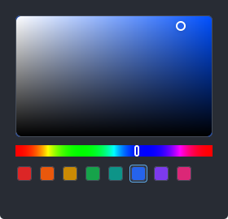

# Color picker

A color picker: a saturation/value field over a hue strip, a `#rrggbb` field
kept in step with both, and an optional row of preset swatches. It works in [`Hsv`](#hsv) rather than in
gpui's `Hsla`, because a gray has no hue of its own: a picker that kept only the
color would forget the hue the moment the knob touched the field's left edge or
bottom row, and the field would jump to red. Hue, saturation and value are what
the pointer moves, so they are what the host keeps.

Source: [color_picker.rs](../../crates/rugpui/src/color_picker.rs).

## Minimal example

From the gallery, at the bottom of the controls column:

```rust
use rugpui::{ColorPicker, Hsv};

ColorPicker::new("accent")
    .value(self.color)
    .field_height(px(96.))
    .presets([0xdc2626, 0x2563eb, 0x16a34a].map(|value| gpui::rgb(value).into()))
    .tab_index(0)
    .on_change({
        let this = this.clone();
        move |color, _window, cx| {
            this.update(cx, |gallery, cx| {
                gallery.color = color;
                cx.notify();
            });
        }
    })
```



*The field fills the width it is given; the knob sits on the color, the strip's
knob on its hue, the hex field spells it, and the preset matching it is ringed.*

## Builder options

| method | argument | default | effect |
| --- | --- | --- | --- |
| `ColorPicker::new` | `id: impl Into<ElementId>` | — | Creates a picker showing white. `id` has to be unique in the window, for the reason a [`Slider`](./slider.md)'s does. |
| `value` | `Hsv` | white | The color shown. |
| `presets` | `impl IntoIterator<Item = Hsla>` | none | A row of swatches under the strip, each picking its color on a click. The one matching the current color (by its `#rrggbb`) is ringed. A gray preset keeps the current hue. |
| `field_height` | `Pixels` | `150px` | Height of the saturation/value field. The strip, the hex field and the presets keep their own heights. |
| `hex_field` | `bool` | `true` | Whether the `#rrggbb` field and the swatch beside it are drawn under the strip. |
| `tab_index` | `isize` | none | Places the picker in the tab order and enables its keys. The hex field takes the next stop. |
| `on_change` | `impl Fn(Hsv, &mut Window, &mut App) + 'static` | none | Fired with the color the picker is moving to, by every way of moving it, and never with the color already showing. |

## `Hsv`

| item | purpose |
| --- | --- |
| `Hsv { h, s, v }` | Hue, saturation and value, each `0.0..=1.0`; hue `0.0` and `1.0` are both red. |
| `Hsv::new(h, s, v)` | Clamps each part into range; a `NaN` part counts as `0.0`. |
| `Hsv::from_hex` / `to_hex` | `#rrggbb` in, the `#` optional and either case; `#rrggbb` in lower case out. |
| `Hsv::from_hsla` / `from_rgba`, `to_hsla` / `to_rgba` | To and from gpui's colors. Alpha is ignored on the way in and `1.0` on the way out. |
| `Hsv::keeping_hue(previous)` | The same color under `previous`'s hue when it is a gray — what a host does with a color typed into a hex field beside the picker. |

## The hex field

The field and the knobs follow each other. A move in the field or the strip, a
key or a preset writes the new color into the hex field; a complete `#rrggbb`
typed there — the `#` optional, either case — moves the knobs and is reported
through `on_change` like any other move. A gray typed in keeps the hue the
knobs were under. Text that is not a color yet is left alone while it is typed,
and moves nothing.

## State the host keeps

Just the `Hsv`. There is nothing to initialize and no drag state; the picker is
rebuilt from `value(..)` on every render. The hex field is the picker's own: a
[`TextInput`](./text-input.md) kept in gpui's element state under the picker's
id, so the id has to stay the same from frame to frame.

## Keyboard and mouse

| gesture | effect |
| --- | --- |
| press or drag in the field | Saturation across, value down — brightest at the top. The drag keeps answering after the pointer leaves the picker, stopping at the edges. |
| press or drag in the strip | The hue. |
| click a preset | That color. |
| type in the hex field | A whole `#rrggbb` moves the knobs. |
| `←` / `→` (focused) | Saturation down / up by 0.01, or 0.1 with `Shift`. |
| `↑` / `↓` (focused) | Value up / down by 0.01, or 0.1 with `Shift`. |
| `PageUp` / `PageDown` (focused) | Turns the hue by ten degrees, wrapping past red. |

`DraggedColor` is the drag payload. It is public so a host listening for drags
itself can name it; `DraggedColor::color(id, position, current)` answers the
color a drag has reached, or `None` for another picker's drag.
