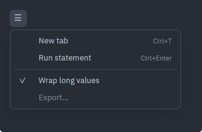
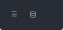
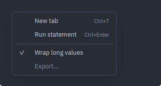

# Menus

Two ways to show the same list of commands: `MenuButton`, a compact toolbar trigger whose dropdown hangs beneath it, and `ContextMenu`, the same panel with no trigger at all, opened wherever the caller says. Reach for them because gpui only builds a native menu bar on macOS — on Windows and Linux the shell has to draw its own.

Source: [menu.rs](../../crates/rugpui/src/menu.rs). Re-exported as `rugpui::{MenuButton, ContextMenu, MenuEntry, Anchor, OpenContextMenu, OpenAppMenu}`.

## The state the host keeps

Both are stateless `RenderOnce` elements. The parent view owns the open flag — and, for a context menu, the pointer position that goes with it — passes it in on every render, and clears it from `on_open_change` / `on_dismiss`. That is the one thing a newcomer gets wrong: a `MenuButton` will never open by itself.

```rust
use rugpui::{MenuButton, MenuEntry};

MenuButton::new("app-menu")
    .tooltip("Everything this window can do")
    .open(self.menu_open)
    .entries(vec![
        MenuEntry::new("New tab").shortcut("Ctrl+T"),
        MenuEntry::new("Run statement").shortcut("Ctrl+Enter"),
        MenuEntry::separator(),
        MenuEntry::new("Wrap long values").checked(self.checked),
        MenuEntry::new("Export…").disabled(true),
    ])
    .on_open_change({
        let this = cx.entity();
        move |open, _window, cx| {
            this.update(cx, |gallery, cx| {
                gallery.menu_open = open;
                cx.notify();
            });
        }
    })
```

## MenuEntry

A row is either a command — a label, an optional shortcut hint and a callback — or a rule.

| method | argument | default | effect |
| --- | --- | --- | --- |
| `MenuEntry::new` | `impl Into<SharedString>` | — | a command row with no hint and no callback |
| `MenuEntry::separator` | — | — | a hairline rule between two groups |
| `.shortcut` | `impl Into<SharedString>` | none | right-aligned muted hint |
| `.on_activate` | `Fn(&mut Window, &mut App)` | none | run on click; the menu closes itself afterwards |
| `.disabled` | `bool` | `false` | drawn muted, no hover, no cursor, **no click handler at all** |
| `.checked` | `bool` | `false` | a `✓` in a column before the label |
| `.label()` | — | — | the row's text (empty for a separator) |
| `.is_separator()` | — | — | whether the row is a rule |

The shortcut is decoration only. The key binding itself is registered by the application (`cx.bind_keys`), and the menu row dispatches the same handler that binding does — the menu is a second way in, never a second implementation. The keys an open menu answers are caught by a keystroke interceptor rather than bound (see [The keyboard](#the-keyboard)); the only bindings this module registers are the two that *open* a menu, below.

`checked` decides a *column*, not a row: a menu with any checked row lays that column out on every row, so the labels stay in a line; a menu with nothing checked never gets the column at all.

A disabled row is inert by having no handler rather than by having one that thinks better of it — which also means clicking it leaves the menu open, since the panel occludes the backdrop a press would otherwise dismiss from. Showing a grayed-out command says "the surface has this, and this is not the moment"; dropping it says nothing.



*The five rows the gallery draws: two commands with `.shortcut(..)`, a `MenuEntry::separator()`, a `.checked(true)` row and a `.disabled(true)` one. The check column is laid out on every row because one row asked for it.*

## MenuButton

| method | argument | default | effect |
| --- | --- | --- | --- |
| `MenuButton::new` | `impl Into<ElementId>` | — | a closed 28 px trigger showing the default hamburger icon (`rugpui::icons::MENU`, a 16 px SVG) |
| `.glyph` | `impl Into<SharedString>` | none (the hamburger icon) | draws this text on the trigger instead of the default icon |
| `.icon` | asset path | none | draws a 16 px SVG instead of the glyph or the default icon; wins over `.glyph` if both are set |
| `.tooltip` | `impl Into<SharedString>` | none | hover label |
| `.open` | `bool` | `false` | whether the dropdown is showing |
| `.entries` | `Vec<MenuEntry>` | empty | the rows, in display order |
| `.on_open_change` | `Fn(bool, …)` | none | the open state the menu would like to be in |
| `.tab_index` | `isize` | not a tab stop | puts the trigger in the tab order; focused, it draws an accent outline and `Enter`, `Space` or `Down` open the menu on its first row |
| `.highlight_first` | `bool` | `false` | opens on the first row that can be run — for a menu the host opened from the keyboard (`OpenAppMenu`) |

`on_open_change` fires with `true` when the trigger is clicked while closed, and with `false` when the trigger is clicked again, when a row is activated, when the pointer goes down anywhere outside the panel, or on `Escape` while the dropdown is open.

The dropdown is a **fixed 280 px** wide, deliberately: the same trigger opens the same menu every time, and a width that followed the entries would make the panel breathe under a button that never moves. It hangs 32 px below the trigger's top-left corner.



*Two closed triggers: the default hamburger icon, and one given `.icon(..)` instead.*

## ContextMenu

Rendered by the view that owns the pointer position — typically from an `on_mouse_down(MouseButton::Right, …)` handler that stored the event's window-space position. The element is absolutely positioned and zero-sized, so it can be dropped in anywhere the view already renders.

```rust
use gpui::{MouseButton, MouseDownEvent, Pixels, Point};
use rugpui::{ContextMenu, MenuEntry};

// in the view: `context: Option<Point<Pixels>>`
div()
    .on_mouse_down(MouseButton::Right, cx.listener(|view, event: &MouseDownEvent, _w, cx| {
        cx.stop_propagation();
        view.context = Some(event.position);
        cx.notify();
    }))
    .children(self.context.map(|position| {
        ContextMenu::new("row-context")
            .position(position)
            .entries(vec![
                MenuEntry::new("Copy"),
                MenuEntry::new("Close others").disabled(only_tab),
            ])
            .on_dismiss({
                // `on_dismiss` takes no event, so `cx.listener` does not fit:
                // capture a handle to the view and update it directly.
                let this = cx.entity();
                move |_window, cx| {
                    this.update(cx, |view, cx| {
                        view.context = None;
                        cx.notify();
                    });
                }
            })
    }))
```

| method | argument | default | effect |
| --- | --- | --- | --- |
| `ContextMenu::new` | `impl Into<ElementId>` | — | empty menu at the window's top-left |
| `.position` | `Point<Pixels>` | `(0, 0)` | window-space point the anchor corner sits at |
| `.anchor` | `Anchor` | `Anchor::TopLeft` | which corner is pinned, and so which way the panel grows |
| `.width` | `Pixels` | content-sized | a fixed width instead of measuring |
| `.entries` | `Vec<MenuEntry>` | empty | the rows |
| `.on_dismiss` | `Fn(&mut Window, &mut App)` | none | called after a row runs, on a press outside, or on `Escape` / `Tab` |
| `.highlight_first` | `bool` | `false` | opens on the first row that can be run — for a menu opened with `OpenContextMenu` |

### Positioning

`.position(p)` puts the panel's *anchor corner* at `p` in window coordinates, and the panel is snapped back inside the window with a 6 px margin if it would hang off an edge. `Anchor` is gpui's own enum, re-exported here so a caller need not reach past this crate for the name.

- `Anchor::TopLeft` (the default) is what a right-click wants: the list hangs down and to the right of the pointer, away from it.
- `Anchor::BottomLeft` is for a trigger along the bottom of the window — a status bar's encoding picker — so the list stands *on* the trigger and opens upward, instead of being snapped back over the thing it was opened from.

Unlike a `MenuButton`, a context menu is **content-sized**: as wide as its widest row, between 180 px and 360 px, with longer labels truncated by ellipsis. The commands a right-click offers depend on what was under the pointer, so two surfaces of the same window can want very differently sized menus. `.width(px)` opts out, for a menu the same trigger reopens over rows that come and go.



*The same entries as a `ContextMenu` at `position(point(px(24.), px(24.)))`: no trigger, and the panel sized to its widest row rather than to a fixed 280 px.*

## How the panel is drawn

Both draw two `deferred` layers over the window, so a menu opened inside a scrolling form is never clipped by it:

1. A full-window **backdrop** (priority 1) that occludes and dismisses on *any* mouse button, so a right-click outside is not swallowed without effect.
2. The **panel** (priority 2), which occludes the backdrop so presses on a row never reach it.

The panel scrolls vertically once it is taller than the window minus the margins, with the wheel locked to that one axis; the rows stay `flex_none` so they scroll past rather than being squeezed.

## The keyboard

An open menu holds the keyboard, wherever the focus is:

| key | effect |
| --- | --- |
| `Up` / `Down` | the previous / next row that can be run, wrapping; separators and disabled rows are skipped |
| `Home` / `End` | the first / last row that can be run |
| a letter | the next row whose label starts with what has been typed (the dropdowns' type-ahead) |
| `Enter` / `Space` | runs the highlighted row and closes the menu; with nothing highlighted, nothing — but the key is still the menu's |
| `Escape` / `Tab` | closes the menu |

The highlight is drawn as the hover is, and the pointer moves it too. A chord with Ctrl, Alt, the platform key or Fn passes through untouched, so the application's shortcuts keep working with a menu open.

Neither menu takes the focus from the surface it was opened over: the keys are caught by a keystroke interceptor that runs ahead of that surface's own bindings and stops their propagation, so an arrow does not also scroll the terminal underneath. Keeping the focus where it is means a field the menu was opened from is not blurred — a grid cell's edit is not committed — and a command the row runs acts on the surface it was opened for; closing the menu leaves the focus exactly where it was. Only a press in the menu's own window counts, a closed `MenuButton` leaves the keys alone, and a menu with no `on_dismiss` / `on_open_change` cannot close itself from the keyboard either.

### Opening a menu from the keyboard

`rugpui::init` binds, with no key context:

| key | action |
| --- | --- |
| `Shift+F10`, the Menu key | `rugpui::OpenContextMenu` |
| `F10` | `rugpui::OpenAppMenu` |

Nothing in this crate handles them, so until an application does the keys go on as though the bindings were not there. A surface with a context menu handles `OpenContextMenu` with `.on_action(..)` and opens its menu where its selection is, with `.highlight_first(true)`; the view that draws the application's `MenuButton` handles `OpenAppMenu` by opening it with `.highlight_first(true)`. A terminal that wants F10 for the program it runs simply does not let the action reach a handler while it has the focus.

```rust
div()
    .on_action(cx.listener(|view, _: &rugpui::OpenAppMenu, _, cx| {
        view.app_menu_open = true;
        view.app_menu_by_keyboard = true;
        cx.notify();
    }))
    .child(
        MenuButton::new("app-menu")
            .tab_index(0)
            .open(self.app_menu_open)
            .highlight_first(self.app_menu_by_keyboard)
            // …
    )
```

## Theme slots

| slot | where |
| --- | --- |
| `background` | panel fill (opaque on purpose — a translucent window allows one tinted fill per pixel) |
| `border` | panel outline and the separator rule |
| `text` | a command row's label, and the open/hovered trigger |
| `text_muted` | a disabled row's label, and the shortcut hint |
| `surface_hover` | a hovered row, and the hovered trigger |
| `surface_active` | the trigger while its menu is open |
| `icon` | resting color of the trigger's icon or glyph |

## Pitfalls

- **Nothing opens itself.** Both are stateless; store the flag and pass it back.
- **`on_dismiss` fires for the outside press, for `Escape` and `Tab`, *and* after a row runs.** Clear your stored position in one place and let the row handlers do their own work.
- **A disabled row does not dismiss the menu.** That is by design; the user must click elsewhere.
- **The context menu's element takes no layout space**, but it must still be a child of something that renders — attach it beside the content it belongs to, not in a detached branch.
- **Shortcut hints are strings you write.** They are never derived from the bindings, so a hint that has drifted from its key binding will lie; the [`TextInput`](./text-input.md) menu shows the pattern for keeping them honest by building both from the same `cfg`.
